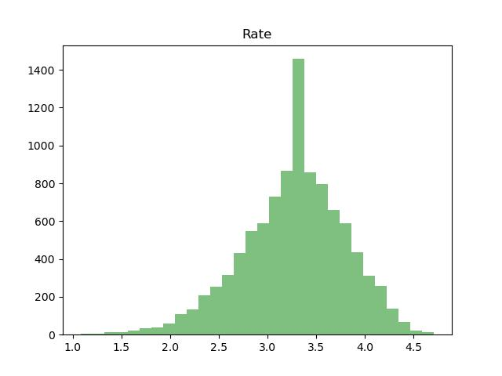
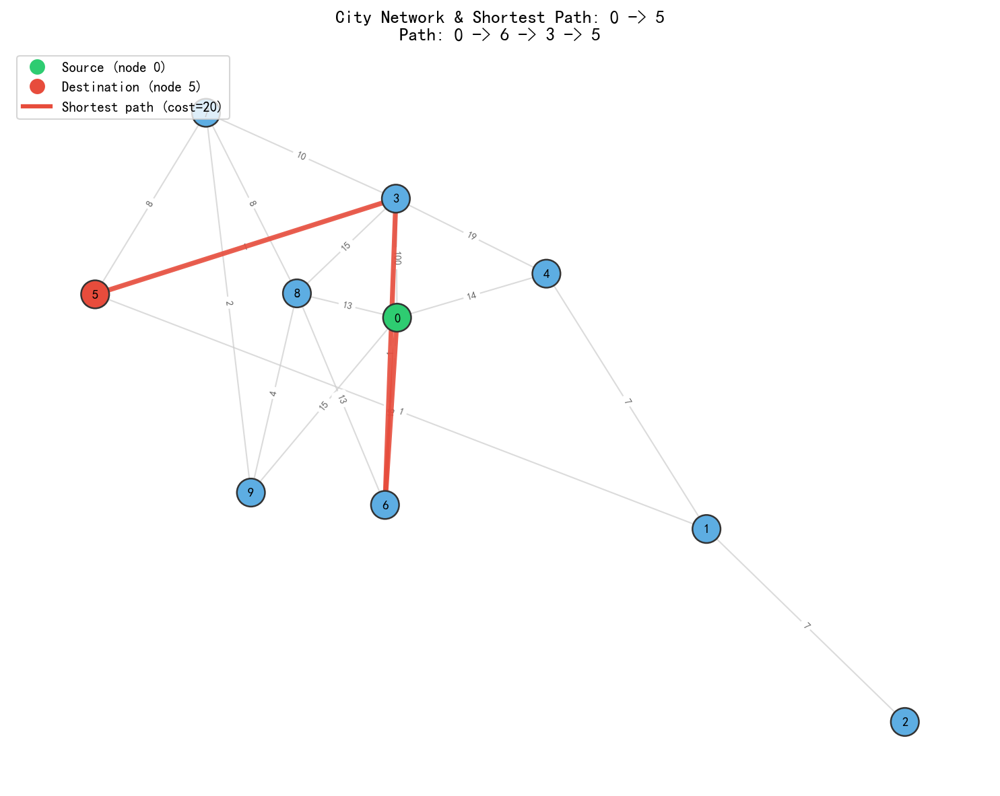

# Python 课程项目集 / Course Projects

复旦大学经济管理试验班课程项目的完整实现与结果。两个项目分别对应**数据分析**与**数据结构与算法**两条主线，代码、数据、结果图表与文档均在仓库内，可复现。

| 项目 | 方向 | 主要技术 |
| --- | --- | --- |
| [letterboxd-movie-analysis](./letterboxd-movie-analysis) | 数据分析 · 文本挖掘 · 聚类与分类 | pandas、NumPy、scikit-learn、Matplotlib、Seaborn、PyECharts |
| [city-instant-delivery-platform](./city-instant-delivery-platform) | 数据结构与算法 · 系统仿真 | 面向对象、邻接表图 + Dijkstra、二叉堆、4 阶 B+ 树、离散事件仿真、pytest |

---

## 一、Letterboxd 电影数据集分析与建模

对 9,971 部电影的公开数据集做端到端分析：数据清洗 → 探索性分析 → 文本挖掘 → 聚类 → 分类建模 → 可视化。

- **文本挖掘**：TF-IDF 提取剧情简介关键词，为评分 4.0 以上的高分影片生成词云；
- **聚类**：8 维用户互动指标标准化后 KMeans（k=4）刻画受众；TF-IDF（5,000 维）聚类（k=6）发现主题相近的影片群；
- **分类**：随机森林（300 棵树、5 折交叉验证）预测评分等级，数值特征基线准确率 **0.948**，加入文本特征后为 0.884；
- **结论**：文本特征在特征重要性上占比更高，但高维稀疏文本会引入噪声，泛化精度反而下降。



## 二、城市即时服务平台（数据结构与算法仿真）

从零实现底层数据结构，再在其上搭建一个即时配送的调度与仿真系统。

- **图**：邻接表存储城市路网，支持节点/边增删改查与 **Dijkstra** 最短路径；
- **优先队列**：基于二叉小顶堆，支持插入、取最小、**更新优先级**、删除与 **top-k**；
- **B+ 树**：4 阶索引，模拟磁盘 I/O 计次，支持插入、点查、范围查询、删除与再平衡；
- **仿真**：离散时间仿真引擎，对比「多因子优先级调度」与 FIFO，输出完成量与超时率；
- **测试**：**80 个 pytest 用例**覆盖全部核心模块。



---

## 运行环境

```bash
python -m venv .venv
source .venv/bin/activate      # Windows: .venv\Scripts\activate
pip install -r requirements.txt
```

各项目的运行方式见其目录下的 README。

## 目录结构

```
.
├── requirements.txt
├── letterboxd-movie-analysis/     # 项目一：数据分析
│   ├── Final.ipynb                # 完整分析流程（含输出图表）
│   ├── Final.html                 # 可直接浏览的 HTML 版本
│   ├── Letterbox Movie Classification Dataset.csv
│   └── Results/                   # 全部结果图表
└── city-instant-delivery-platform/ # 项目二：数据结构与算法
    ├── main.py / demo.py          # 交互菜单 / 一键演示
    ├── graph.py  priority_queue.py  bplus_tree.py
    ├── order.py  courier.py  scheduler.py  simulator.py
    ├── data_generator.py  visualize.py  test_all.py
    ├── docs/                      # 系统设计文档与答辩材料
    └── *.png                      # 可视化结果
```

## 作者

杨浩源（Haoyuan Yang）· 复旦大学 经济管理试验班 · 25300690043@m.fudan.edu.cn
