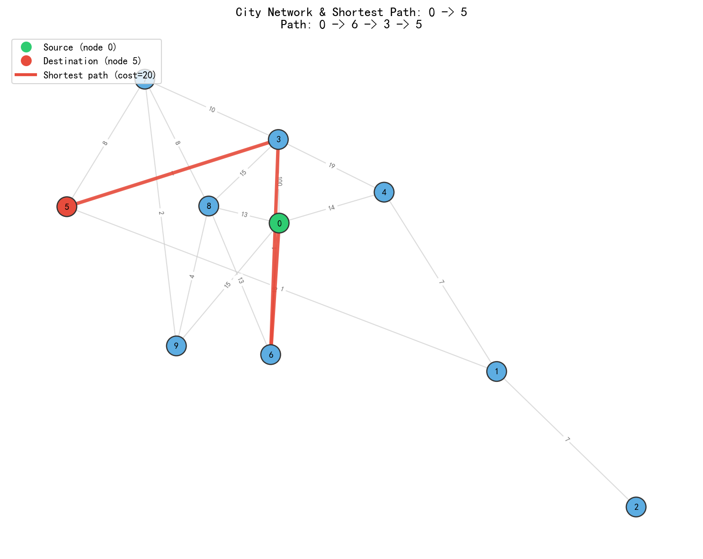
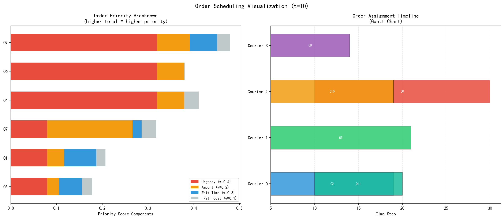
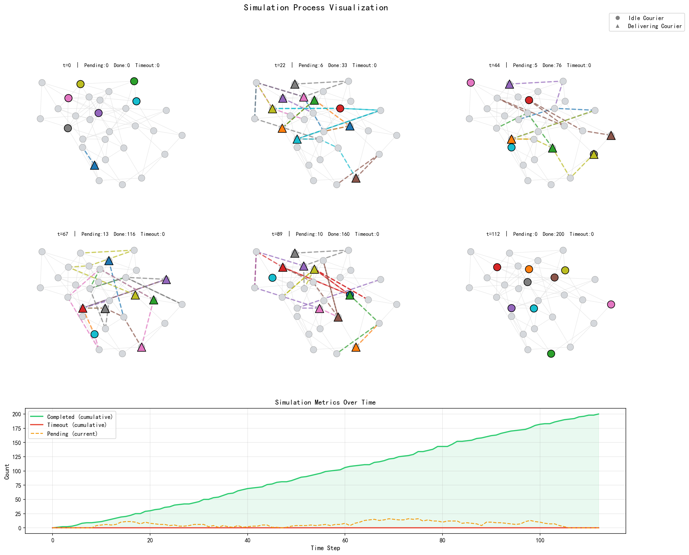

# 城市即时服务平台：数据结构与算法仿真系统

> 数据结构与算法导论课程期末项目 · 个人独立完成 · 2026.06

用 Python 从零实现三种底层数据结构，并在其上搭建一个「城市即时配送」的调度与仿真系统：路网求最短路、订单按优先级调度、订单用 B+ 树落盘索引、整条链路做离散时间仿真。

## 系统设计

| 模块 | 职责 | 关键实现 |
| --- | --- | --- |
| `graph.py` | 城市路网 | 邻接表存储，节点/边增删改查，**Dijkstra** 最短路径 |
| `priority_queue.py` | 订单优先级队列 | 二叉**小顶堆**，支持插入、取最小、**更新优先级**、删除、**top-k** |
| `bplus_tree.py` | 订单索引 | **4 阶 B+ 树**，模拟磁盘 I/O 计次，支持插入、点查、范围查询、删除与再平衡 |
| `order.py` / `courier.py` | 数据模型 | 订单（起终点、金额、紧急度、截止时间、状态）、骑手（接单、逐步移动、完成配送） |
| `scheduler.py` | 调度 | 多因子优先级计算 + 最近骑手分配 |
| `simulator.py` | 仿真 | 离散时间引擎，支持优先级 / FIFO 两种策略对比 |
| `data_generator.py` | 造数据 | 随机生成连通路网、订单、骑手 |
| `visualize.py` | 可视化 | 路径、调度过程、仿真过程 |

## 调度策略

系统实现了两种订单优先级策略并做对比：

**多因子优先级（Priority）**

```
P = -(w1 * urgency/5 + w2 * amount/100 + w3 * wait_time/30 - w4 * path_cost/50)
```

默认权重 `urgency=0.4, amount=0.2, wait_time=0.3, path_cost=0.1`；值越小优先级越高，即优先处理**紧急度高、金额大、等待久、路径短**的订单。

**先到先服务（FIFO）**：把权重设为只保留 `wait_time`，等价于按到达顺序处理，作为对照组。

## 仿真场景与结果

30 节点 / 80 边路网、200 个订单、10 名骑手、时间跨度 0–100 的离散时间仿真：

- 对比两种策略的**完成订单数、超时数、待处理订单数**随时间的变化；
- 输出订单优先级因子分解图与骑手调度甘特图，用于解释“为什么这单先送”。





## 测试

**80 个 pytest 用例**覆盖全部核心模块：

```bash
python test_all.py
# 或
pytest -v
```

覆盖内容：图的基本操作与最短路、优先队列（含 top-k 与优先级更新）、B+ 树（插入/点查/范围查询/删除再平衡/**I/O 计次**）、调度器（订单管理与骑手分配）、骑手逐步配送、仿真（正常/超时/策略对比）、数据生成器（路网连通性、订单与骑手合法性）。

## 如何运行

```bash
cd city-instant-delivery-platform
python main.py      # 交互菜单：四个模块的 demo
python demo.py      # 一键跑完全部演示并生成图表
python test_all.py  # 运行单元测试
```

## 文档

设计思路与底层原理分析见 `docs/城市即时服务平台 系统设计与底层原理分析文档.docx`，答辩演示见 `docs/城市即时服务平台系统.pptx`。
