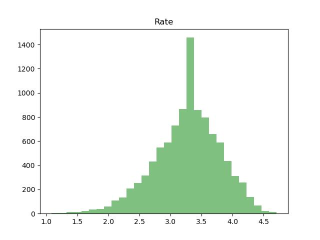
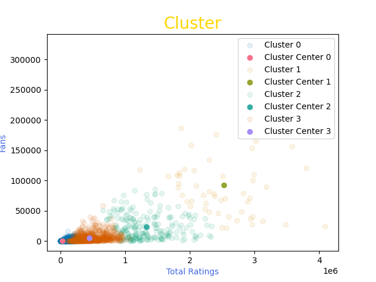
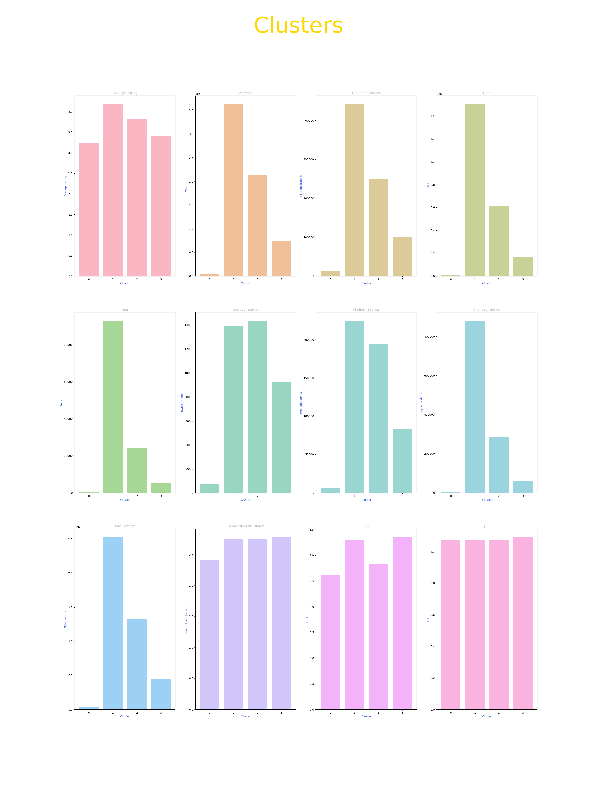

# Letterboxd 电影数据集分析与建模

> Python 数据分析课程项目 · 个人独立完成 · 2025.11 – 2026.01

对 [Letterboxd](https://letterboxd.com/) 公开数据集（**9,971 部电影**、57 种语言、27 类题材）做端到端分析，回答两个问题：**什么样的电影更受欢迎？评分与哪些因素相关？**

## 数据

每条记录包含：片名、平均评分、片长、原始语言、题材、导演、工作室、剧情简介，以及用户互动指标 `Watches / Likes / Fans / List_appearances / Total_ratings / Lowest_ratings / Medium_ratings / Highest_ratings`。

## 方法

**1. 数据清洗**
去重、缺失值处理、片长异常值截断（80–280 分钟）、把题材/导演/工作室等字符串字段解析为结构化列表。

**2. 探索性分析**
评分与片长分布直方图、题材占比饼图、题材与评分的关系（箱线图）、语言与评分的关系、Watches–Likes–Fans 三维散点、评分最高/最低影片对比。

**3. 文本挖掘**
- TF-IDF 提取剧情简介高频关键词（去除英文停用词）；
- 对评分 4.0 以上的高分影片单独做 TF-IDF，生成词云（`Results/高分电影描述中的关键词.html`）。

**4. 聚类**
- **受众聚类**：8 维用户互动指标标准化后 KMeans，用肘部法 + 轮廓系数在 k=2..6 中选择 **k=4**；
- **主题聚类**：TF-IDF（5,000 维）后 KMeans **k=6**，发现主题相近的影片群，并比较各簇平均评分。

**5. 分类建模**
- **人气判别**：以互动指标 70% 分位数为阈值构造“人气”标签，决策树 + 网格搜索调参，可视化分裂规则；
- **评分分级**：以评分三档（低/中/高）为目标，随机森林（300 棵树、5 折交叉验证）对比数值特征与文本特征。

## 主要结果

| 指标 | 结果 |
| --- | --- |
| 随机森林 · 仅 9 个数值特征 | 5 折交叉验证准确率 **0.948** |
| 随机森林 · 数值 + 5,000 维 TF-IDF | 5 折交叉验证准确率 **0.884** |
| KMeans（k=4）受众分层 | 平均评分 3.24 – 4.18，平均粉丝量 267 – 92,942 |
| TF-IDF 聚类（k=6）最高分簇关键词 | life / family / love / man / young |

**结论与反思**：按特征重要性看，文本特征贡献高于数值特征；但从泛化精度看，高维稀疏的 TF-IDF 特征反而引入噪声，准确率不升反降。这说明“特征重要性高”不等于“加入后模型更好”，后续应做特征筛选或降维，而不是简单堆特征。

> 注：决策树在“人气”标签上的测试集准确率接近 1.0，但该标签本身由同一批互动指标阈值构造，属于标签泄漏，因此这里不把它当作预测能力的证据，只作为规则可解释性的展示。

## 如何运行

```bash
cd letterboxd-movie-analysis
pip install -r ../requirements.txt
jupyter notebook Final.ipynb
```

> `Final.ipynb` 开头有 `os.mkdir('Results')`，若 `Results/` 已存在会报 `FileExistsError`，运行前可先删除该目录或注释掉这一行。

## 结果图表





## 目录

```
letterboxd-movie-analysis/
├── Final.ipynb        # 完整分析流程，含输出
├── Final.html         # 免安装浏览版本
├── Letterbox Movie Classification Dataset.csv
└── Results/           # 全部可视化结果
```
